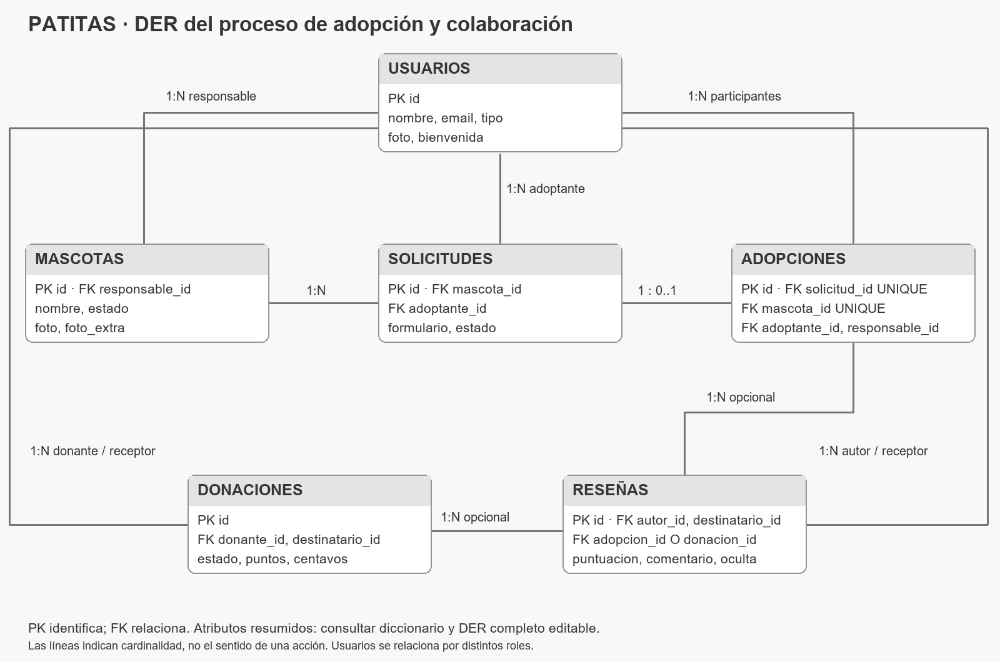
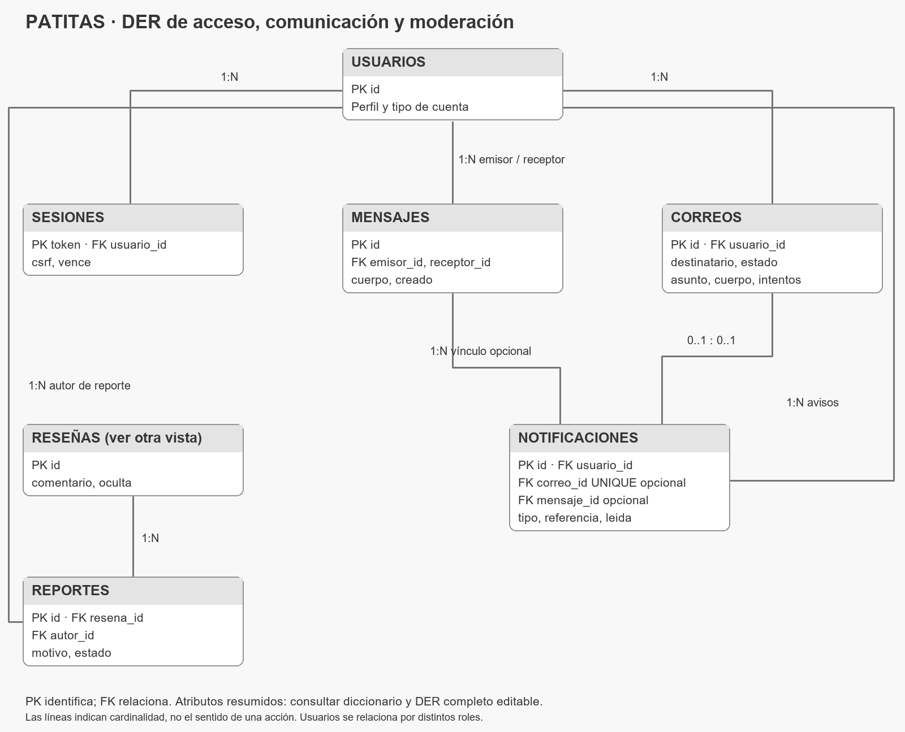

# Diseño detallado y DER de PATITAS

## Arquitectura implementada

PATITAS es una aplicación local de tres partes: interfaz en el navegador, servidor Node.js y persistencia SQLite. No utiliza React, Express ni un servidor de base de datos externo. Frontend y API se sirven desde el mismo origen.

servidor.js lee .env si existe, abre datos/patitas.sqlite, crea la aplicación y escucha en 127.0.0.1. backend/app.js recibe HTTP, sirve recursos públicos, interpreta JSON, comprueba sesión y token CSRF y elige el servicio. backend/servicios.js aplica reglas de negocio. backend/base.js ofrece consultas parametrizadas y transacciones, además de crear y migrar el esquema. backend/correo.js procesa los emails persistidos.

La separación actual no tiene archivos Controller y Repository independientes por entidad. Las responsabilidades equivalentes están concentradas en app.js, servicios.js y el objeto repositorio de base.js. Una próxima camada puede separarlas sin afirmar que esa reorganización ya existe.

## Diseño de interfaz

La pantalla inicial contiene ingreso y registro. Al entrar aparecen catálogo, refugios y rescatistas, Mi espacio, contador de PATITAS, campana y cierre de sesión. Mi espacio cambia de pestañas según el rol. Los formularios de mascota, adopción y reseña usan un diálogo; los chats ocupan su propia sección.

public/index.html contiene la estructura inicial y contenedores vacíos. public/app.js genera la mayor parte de la interfaz con JavaScript. Por eso no se encontrará todo el catálogo escrito dentro del HTML. public/estilos.css define el aspecto, las tarjetas, formularios y adaptación a pantallas pequeñas.

## DER y cardinalidades

El archivo DER.mmd contiene el diagrama entidad relación editable. El diccionario adjunto se obtiene de una base vacía creada con el código, sin leer los datos reales del usuario. Las relaciones siguientes explican los roles que un dibujo resumido puede agrupar.

| Tabla dependiente y clave foránea | Tabla referida | Cardinalidad y significado |
| --- | --- | --- |
| sesiones.usuario_id | usuarios.id | Un usuario puede tener muchas sesiones |
| mascotas.responsable_id | usuarios.id | Un responsable publica muchas mascotas |
| solicitudes.mascota_id | mascotas.id | Una mascota recibe muchas solicitudes |
| solicitudes.adoptante_id | usuarios.id | Un adoptante realiza muchas solicitudes |
| adopciones.solicitud_id | solicitudes.id | Una solicitud genera como máximo una adopción; cada adopción usa una solicitud única |
| adopciones.mascota_id | mascotas.id | Una mascota tiene como máximo una adopción; la columna es única |
| adopciones.adoptante_id y responsable_id | usuarios.id | Un usuario participa en muchas adopciones según su rol |
| donaciones.donante_id y destinatario_id | usuarios.id | Un usuario dona o recibe muchas colaboraciones |
| resenas.autor_id y destinatario_id | usuarios.id | Un usuario escribe y recibe muchas reseñas |
| resenas.adopcion_id o donacion_id | adopciones.id o donaciones.id | Cada reseña pertenece exactamente a uno de los dos tipos de experiencia |
| reportes.resena_id y autor_id | resenas.id y usuarios.id | Una reseña puede tener reportes de distintos usuarios |
| mensajes.emisor_id y receptor_id | usuarios.id | Un usuario envía y recibe muchos mensajes |
| correos.usuario_id | usuarios.id | Un usuario recibe muchos registros de correo |
| notificaciones.usuario_id | usuarios.id | Un usuario recibe muchos avisos |
| notificaciones.correo_id | correos.id | Vínculo opcional y único: un correo tiene como máximo un aviso asociado |
| notificaciones.mensaje_id | mensajes.id | Vínculo opcional para marcar correctamente mensajes mostrados |

No hay tabla conversaciones: una sala se identifica por el par de usuarios y su historial se consulta en mensajes. Tampoco hay tabla refugios: refugio y particular son tipos de usuarios. Esto refleja el diseño actual, no un modelo inventado para el informe.

Las vistas agrupan relaciones por tema; USUARIOS y RESEÑAS son las mismas entidades en ambas. La relación directa de mascota con adopción y todas las referencias exactas se detallan en la tabla de relaciones y el archivo Mermaid, evitando sobrecargar el dibujo.

## Integridad y restricciones

Las PK son identificadores enteros salvo sesiones.token, cuya PK es texto. Las FK se habilitan con PRAGMA foreign_keys=ON. El email de usuarios es único. Los estados y varias categorías tienen restricciones CHECK. Las tablas no definen borrado en cascada; la interfaz conserva historiales y archiva publicaciones.

Un índice único parcial evita solicitudes repetidas mientras estén pendiente, en_revision o aprobada. solicitud_id y mascota_id son únicos en adopciones. Las reseñas tienen un CHECK que exige exactamente una experiencia y dos índices únicos parciales para evitar dos reseñas del mismo autor sobre la misma experiencia. El par resena_id y autor_id es único en reportes. notificaciones.referencia es una referencia lógica según el tipo de aviso; no es una FK general a una sola tabla.

Las contraseñas, estados de aprobación, puntos y comprobaciones de pertenencia se validan también en servicios. El esquema por sí solo no impide todas las combinaciones indebidas, por ejemplo que una donación tenga emisor y receptor iguales: esa regla está en el servicio y debe conservarse al ampliar rutas.

## Contratos de API

Todas las rutas de comunidad requieren sesión. Las operaciones autenticadas que cambian datos reciben JSON y X-CSRF-Token. Registro e ingreso son las excepciones de acceso inicial. Los id de la URL se validan como enteros positivos.

| Método y ruta | Función y autorización |
| --- | --- |
| POST /api/registro; POST /api/ingreso | Crear cuenta o sesión y cookie |
| GET /api/yo; POST /api/salir | Consultar o cerrar la sesión propia |
| PATCH /api/perfil | Actualizar campos permitidos del propio perfil |
| GET /api/mascotas | Catálogo disponible; buscar, especie y pagina como parámetros |
| POST /api/mascotas | Publicar como refugio o particular con foto |
| GET /api/mascotas/:id | Ficha; una publicación archivada solo es visible para su responsable |
| PATCH /api/mascotas/:id; DELETE /api/mascotas/:id | Editar o archivar por su responsable |
| GET /api/refugios; GET /api/perfiles/:id | Perfiles de comunidad con restricciones para adoptantes |
| GET /api/panel | Registros propios y experiencias en las que participa |
| POST /api/solicitudes | Solicitud de un adoptante para mascota disponible |
| PATCH /api/solicitudes/:id | Responsable resuelve o solicitante cancela una activa |
| PATCH /api/adopciones/:id | Responsable guarda seguimiento |
| POST /api/donaciones | Registrar colaboración para otro refugio o particular |
| PATCH /api/donaciones/:id | Destinatario confirma/rechaza; donante cancela pendiente |
| POST /api/resenas | Calificar una experiencia propia completada |
| POST /api/resenas/:id/reportar | Reportar una reseña visible |
| PATCH /api/reportes/:id | Moderación por admin |
| POST /api/mensajes | Mensaje al interlocutor autorizado |
| GET /api/conversaciones | Lista de interlocutores del usuario actual |
| GET /api/chat/:id | Sala con esa persona; antes pagina hacia mensajes anteriores |
| POST /api/chat/:id/leido | Marca leído hasta el mensaje indicado por hasta |
| GET /api/notificaciones | Últimos cien avisos propios y contador global de no leídas |
| POST /api/notificaciones/leer-todas | Marca todos los avisos propios |
| POST /api/notificaciones/:id/leer | Marca un aviso propio |
| POST /api/correos/:id/reintentar | Reintenta correo propio local o fallido con Gmail configurado |

La exportación CSV se construye en el navegador a partir de su planilla autorizada; no existe un endpoint separado para exportar. Las rutas de actualización esperan los campos que envían los formularios actuales, no cualquier modificación arbitraria.

## Respuestas y límites

Las respuestas usan JSON; el error controlado se expresa como {error: mensaje}. Se usan 201 para altas y 200 para consultas y cambios correctos; 400 para datos inválidos; 401 para sesión ausente; 403 para falta de permiso; 404 para rutas o registros no disponibles; 409 para conflictos; 413 para tamaño; 415 para tipo de contenido; 429 para exceso de intentos y 500 para errores internos sin detalle sensible. Algunas rutas específicas responden 405 a métodos no admitidos; el enrutador no garantiza ese código para toda combinación desconocida.

El catálogo muestra 24 mascotas por página. El panel limita a 500 solicitudes, adopciones, mascotas propias y donaciones; a 200 mensajes heredados y reportes pendientes; a 100 correos. La lista de conversaciones tiene tope de 200. Una sala carga cien mensajes y usa un registro adicional para saber si hay anteriores. Los perfiles muestran hasta cien mascotas y cincuenta reseñas. Estos límites no sustituyen una estrategia de escalado.

## Persistencia y comunicaciones

SQLite utiliza WAL y un tiempo de espera de bloqueo de cinco segundos. Las migraciones comprueban columnas antes de agregarlas y reconocen los cinco puntos de bienvenida sin sumarlos en cada arranque. La fórmula de puntos consulta ese valor fijo y las donaciones confirmadas.

La cola procesa hasta cinco emails por ciclo de cinco segundos y evita ejecutar dos procesamientos simultáneos. Usa Gmail SMTP con TLS directo en el puerto 465. «Enviado» significa aceptación por el servidor SMTP, no recepción confirmada por la persona. Si un envío queda interrumpido, pasa a error para revisión y no se reenvía automáticamente.
